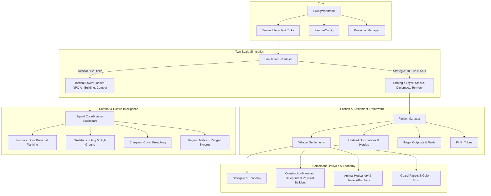

# Architecture Specification — Minecraft: Living World

## 1. System Overview



## 2. Package Structure
```text
src/main/java/livingworld/
├── LivingWorldMod.java            # Mod entrypoint & registry initializers
├── config/FeatureConfig.java      # Configuration flags, rates, difficulty
├── core/
│   ├── ProtectionManager.java    # Player claims, base protection, pet immunity
│   ├── SimulationScheduler.java  # Staggered tick scheduler for strategic/tactical tasks
│   └── EventHooks.java           # Server lifecycle and entity event wiring
├── faction/
│   ├── Faction.java              # Faction identity, claims, reputation, relations
│   ├── FactionManager.java       # Global faction registry and persistence
│   └── FactionType.java          # VILLAGER, UNDEAD, ILLAGER, PIGLIN_TRIBE
├── settlement/
│   ├── Settlement.java           # Settlement state machine, boundary, stockpile
│   ├── SettlementManager.java    # Spatial index & lifecycle for settlements
│   ├── BlueprintRegistry.java    # Modular vanilla-block building blueprints
│   ├── ConstructionManager.java  # Physical loaded block placement queue
│   └── ReputationManager.java    # Player trust, trade discounts, golem forgiveness
├── economy/
│   ├── Stockpile.java            # Food, wood, stone, iron inventories
│   ├── HerderManager.java        # Livestock breeding and pasture maintenance
│   └── ButcherManager.java       # Sustainable adult harvest & resource processing
├── ai/
│   ├── SquadController.java      # Shared blackboard, squad leaders, rally points
│   ├── ZombieBreachGoal.java     # Door/trapdoor destruction on all difficulties
│   ├── SkeletonTacticsGoal.java  # Distance maintenance, kiting, high ground
│   ├── CreeperBreachGoal.java    # Targeted obstruction breaching
│   └── MeleeIllagerGoal.java     # Melee combat role for illagers
├── undead/
│   ├── UndeadOccupationManager.java # Capture, occupation state, zombie jobs
│   ├── ZombieHordeManager.java      # Capped horde spawns & armored commanders
│   └── InfectionManager.java        # Conversion of eligible livestock to zombie variants
├── bosses/
│   ├── GiantZombieBoss.java      # Multi-phase giant zombie encounter
│   └── DragonPhaseController.java# Ender dragon phase state machine & counterplay
├── ocean/
│   └── SharkEntity.java          # Ocean predator ecology, hunting, neutral-until-provoked
├── travel/
│   └── MinecartSpeedController.java # Safe high-speed minecarts & rail UX
└── exploration/
    ├── GlobalMapManager.java     # Explored chunks fog-of-war map & waypoints
    └── TrialChamberClues.java    # In-game hints & upgraded exploration loot
```

## 3. Data Persistence & Save Strategy
- Data stored per-world in `world/data/livingworld_settlements.dat` and `world/data/livingworld_factions.dat` using vanilla `SavedData` / NBT compound tags.
- Safe schema versioning allows seamless migration and graceful removal without corrupting saves.
