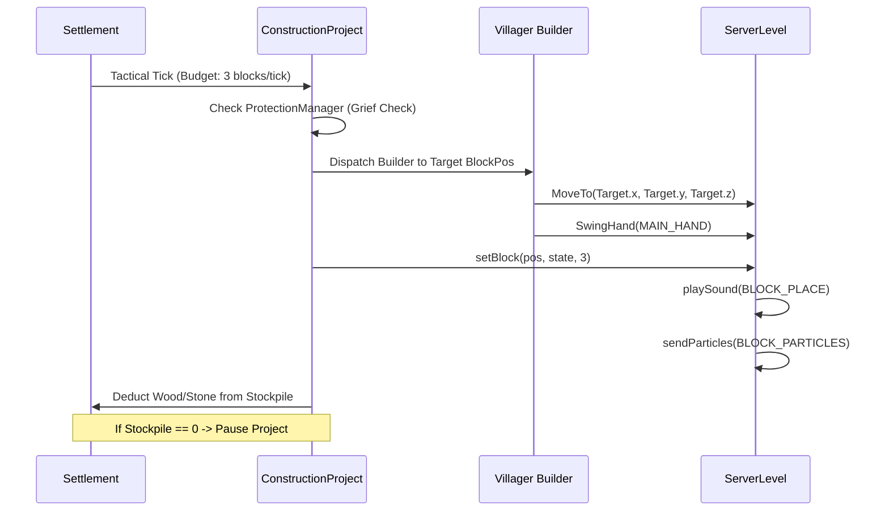

# CONSTRUCTION.md — Living World v0.2.0 Architectural Blueprint & Construction Engine

## 1. Architectural Philosophy
In Minecraft: Living World v0.2.0, buildings are **never** generated instantaneously via commands or magic box paste operations. All structures are constructed block-by-block by living villager builders who physically walk to candidate locations, place blocks, swing their hands, and trigger authentic block placement sounds and particles.

All blueprints strictly conform to the **Vanilla Invariant**: only vanilla blocks (Oak wood, Cobblestone, Stone Bricks, Glass Panes, Beds, Workstations, Torches, Lanterns) are used. Zero modded block dependencies exist in the structure files.

---

## 2. The 12 Architectural Blueprints

| Blueprint ID | Display Name | Footprint (W×H×D) | Block Count | Primary Materials | Gameplay Purpose |
|---|---|---|---|---|---|
| `small_oak_house` | Cozy Timber Cottage | 5×5×5 | 105 | Cobblestone, Oak Logs, Planks, Glass, Bed | Houses 4 villagers; expands settlement capacity. |
| `two_story_house` | Two-Story Residence | 7×7×7 | 210 | Cobblestone, Oak Planks, Stripped Logs, Beds | Houses 6 villagers; urban multi-family dwelling. |
| `farmhouse` | Rural Farmhouse | 7×5×6 | 135 | Wood Planks, Thatch/Hay, Furnace, Chest | Rural farmer residence with direct crop storage. |
| `workshop` | Artisan Workshop | 6×5×6 | 120 | Cobblestone, Smithing Table, Blast Furnace | Workstation hub for weaponsmiths, armorers, and masons. |
| `barn` | Timber Hay Barn | 8×6×8 | 180 | Oak Logs, Planks, Hay Bales, Fences | Livestock shelter and fodder storage depot. |
| `warehouse` | Storage Granary | 8×5×7 | 175 | Stone Bricks, Oak Planks, Barrels, Chests | Stockpile consolidation depot for village goods. |
| `market` | Covered Bazaar | 7×4×7 | 110 | Wool Stalls, Wooden Fences, Workstations | Central commercial hub for merchant villagers. |
| `barracks` | Military Barracks | 9×5×7 | 195 | Cobblestone, Iron Bars, Armor Stands, Beds | Bunks and armory for up to 6 Village Guards. |
| `watchtower` | Fortified Watchtower | 5×9×5 | 145 | Cobblestone, Oak Logs, Battlements, Torches | Elevated vantage point; increases garrison capacity. |
| `gatehouse` | Fortified Gatehouse | 9×7×5 | 225 | Cobblestone, Stone Bricks, Portcullis Bars | Perimeter choke-point defense against hordes/raids. |
| `palace` | Imperial Palace | 11×9×9 | 380 | Stone Bricks, Polished Granite, Red Carpet, Gold | Throne room and royal residence for Imperial capitals. |
| `wheat_farm` | Irrigated Farmland | 7×1×7 | 49 | Farmland, Water, Wheat Crops, Oak Fences | Sustained food production generating wheat and seeds. |
| `livestock_pen` | Fenced Livestock Pen | 7×2×7 | 56 | Oak Fences, Gates, Water Troughs, Hay | Enclosure for sustainable cattle, sheep, and pig husbandry. |

---

## 3. Builder NPC Workflow

---

## 4. Construction Safeguards & Player Protection
The `ProtectionManager` guarantees that autonomous construction never infringes on player autonomy:
1. **Player-Placed Blocks**: Any block placed by a player is recorded in the immutable `playerPlacedBlocks` spatial registry. Builders will skip candidate coordinates rather than overwrite player structures.
2. **Container Immunity**: Chests, trapped chests, barrels, furnaces, brewing stands, and ender chests are classified as `CRITICAL_BLOCKS` and cannot be replaced or cleared.
3. **Bed & Respawn Safety**: Villager and player beds cannot be cleared during plot leveling.
4. **Portal Safeguards**: Nether Portals, End Portals, and Sift Portals are protected from structural interference.
