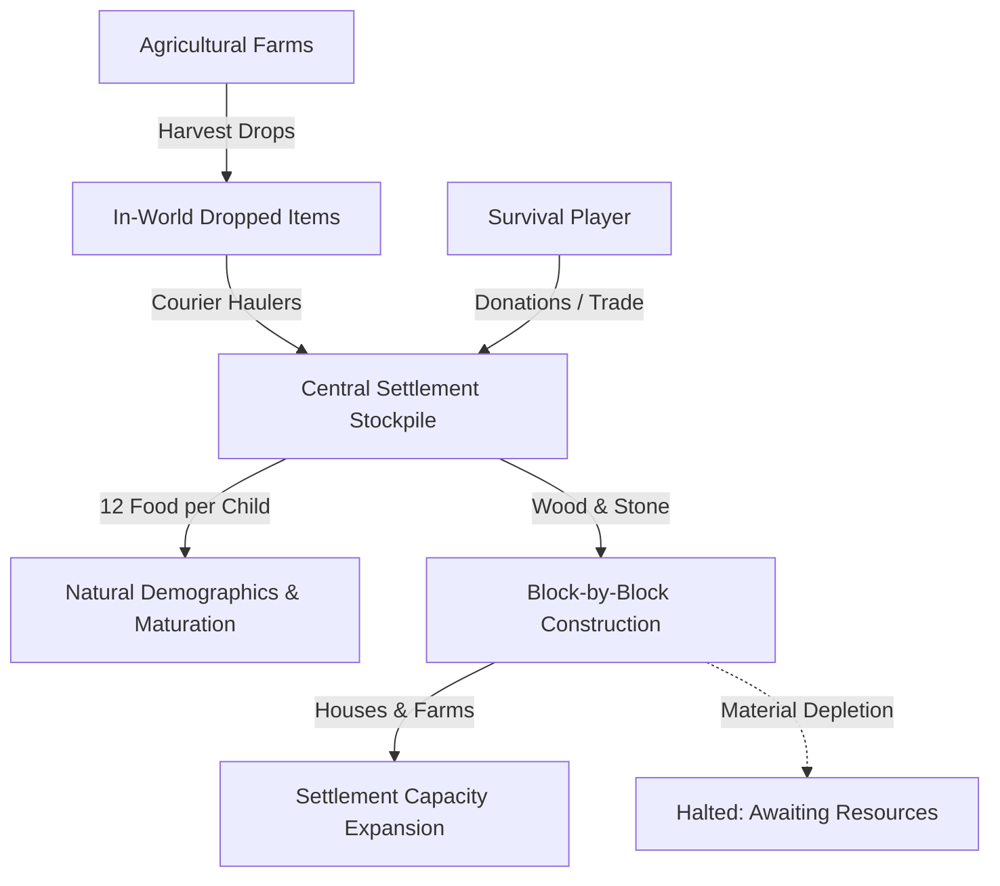

# ECONOMY.md — Living World v0.2.0 Economy, Logistics & Demographics Specification

## 1. Overview
Living World replaces Minecraft's static trading window mechanics with a living, physical settlement economy. Resources flow through real physical world entities: farmers harvest crops, couriers transport goods, stockpiles accumulate materials, builders consume resources block-by-block, and players can participate directly through trade, donations, and questing.

---

## 2. Stockpile Resource Categories

Settlements maintain persistent inventory accounts across 6 standardized resource types:

| Resource Type | Accepted Items | In-Game Production | Economic Purpose |
|---|---|---|---|
| `FOOD` | Wheat, Bread, Carrots, Potatoes, Beetroots, Apples | Village Farmlands, Livestock Slaughter | Sustains population; required for villager breeding (12 food/child) |
| `WOOD` | Any Log or Plank variant | Foresters, Player Contributions | Building framing, roofing, furniture, and tools |
| `STONE` | Cobblestone, Stone, Deepslate | Quarrying, Excavations, Player Contributions | Foundations, watchtowers, barracks, and palace masonry |
| `IRON` | Iron Ingots, Raw Iron, Iron Nuggets | Mineshafts, Golem Forges, Trading | Guard equipment, tools, and advanced construction |
| `LEATHER` | Leather | Cattle Husbandry, Tanneries | Armor crafting, books, saddles, and map casings |
| `WOOL` | Any Wool block | Sheep Shearing | Bed production, carpeting, banners, and decor |

---

## 3. Physical Courier & Logistics System

In vanilla Minecraft, harvested crops either float until despawned or clog villager internal inventories. In Living World:
1. **Detection**: `EconomyManager.tickLogistics` continuously monitors the settlement territory for dropped items within a 24-block vertical column.
2. **Dispatch**: Unemployed or apprentice villagers are assigned as Couriers.
3. **Transport**: The courier physically walks to the dropped resource, plays an item pickup animation, swings their hand, and emits sound.
4. **Deposit**: The resource is transferred to the settlement's central stockpile and recorded in the economic transaction ledger.
5. **Work Recognition**: The courier receives work contribution credits via `VillagerIdentityManager`.

---

## 4. Construction Shortage Mechanics

Construction is never free or instantaneous. Every blueprint has an explicit resource cost:
- `small_oak_house`: 20 Wood, 12 Stone
- `two_story_house`: 45 Wood, 30 Stone
- `farmhouse`: 35 Wood, 20 Stone
- `workshop`: 30 Wood, 40 Stone
- `warehouse`: 50 Wood, 35 Stone
- `market`: 40 Wood, 25 Stone
- `barracks`: 40 Wood, 60 Stone
- `watchtower`: 25 Wood, 50 Stone
- `gatehouse`: 35 Wood, 80 Stone
- `palace`: 100 Wood, 150 Stone, 20 Iron

If a settlement's stockpile runs out of Wood or Stone (`wood == 0 && stone == 0`), the active construction project immediately halts until supplies are replenished by couriers, miners, or players.

---

## 5. Player Trade & Voluntary Donations

Players can directly invest in village expansion:
1. Hold any acceptable raw material (e.g. Oak Logs, Cobblestone, Wheat, Iron Ingots).
2. Right-click any adult villager within a registered settlement.
3. Up to 16 items are deposited into the settlement's stockpile.
4. The player receives immediate reputation gains (+1 reputation per 4 items), green villager celebration particles (`HAPPY_VILLAGER`), and audio confirmation (`VILLAGER_YES`).
5. Halting construction projects will immediately resume upon receiving required materials.

---

## 6. Sustainable Demographics & Breeding

Villager reproduction follows realistic demographic rules:
- **Housing Limit**: Villagers only reproduce if `population < housingCapacity`.
- **Food Reserve**: At least 12 units of `FOOD` must be available in the settlement stockpile.
- **Parental Presence**: At least 2 adult villagers must be present in the settlement area.
- **Cooldown**: 45-second spacing between births per settlement to prevent exponential population spikes.
- **Maturation**: Newborns receive a culturally styled name and the title `"the Youngster"`. They spend their childhood socializing around village bells and wells before maturing into trade professionals or military guards.
