# MOD_INTEGRATION_PLAN.md — Systematic Integration Blueprint for v0.2.0

**Target:** Minecraft Java Edition 26.3 | Fabric Loader 0.20.1  
**Instance:** `instances/LivingWorld/`  

---

## 1. System Integration Architecture

Living World acts as the **master coordinating simulation layer**, orchestrating third-party mods, world generation hooks, and native custom systems:

```mermaid
flowchart TD
    subgraph LivingWorldCoordinationLayer [Living World Master Controller]
        WSC[WorldSimulationController]
        SM[SettlementManager]
        EM[EconomyManager]
        CM[ConstructionManager]
        PM[ProfessionManager]
        MM[MilitaryManager]
        FM[FactionManager]
        ENC[EncounterManager]
        EPM[EntityPresentationManager]
        IM[IntegrationManager]
    end

    subgraph ExternalMods [Verified 26.3 Mod Dependencies]
        SIFT[Mielon's The Sift]
        GECKO[GeckoLib 5.5.7]
        XAERO[Xaero's World Map & Minimap]
        REGROWTH[Regrowth: Revamped]
        STRUCT[Structory & Explorify]
    end

    subgraph NativeSystems [Native Specialized Systems]
        ZSIEGE[Zombie Siege Mining & Tools]
        EMPIRES[Villager Empires 1 in 64]
        ARMORWEAR[Armor Wear & Visual History]
        TACTICS[Skeleton & Illager Tactical AI]
        ENTITIES[Genuine Custom Mobs & Spawn Eggs]
    end

    WSC --> SM
    WSC --> FM
    SM --> CM
    SM --> EM
    SM --> PM
    SM --> MM
    ENC --> ZSIEGE
    ENC --> TACTICS
    ENC --> ENTITIES

    IM --> SIFT
    IM --> GECKO
    IM --> XAERO
    IM --> REGROWTH
    IM --> STRUCT
    EPM --> GECKO
    EPM --> ARMORWEAR
```

---

## 2. Integration Milestones & Implementation Sequencing

### Phase 1: Dependency Ingestion & Instance Staging
1. Download official verified 26.3 Fabric binaries:
   - `mielon's-the-sift-2.0.2-mc26.3-fabric.jar`
   - `geckolib-fabric-26.3-5.5.7.jar`
   - `xaeroworldmap-fabric-26.3-1.47.2.jar`
   - `xaerominimap-fabric-26.3-26.6.2.jar`
   - `regrowth-revamped-fabric-1.1.0+26.3.jar`
   - `Structory_26.3_v1.3.18+26.3.jar`
   - `Explorify v1.6.6.mod.jar`
2. Deploy into `instances/LivingWorld/minecraft/mods/`.
3. Validate client boot, dimensional transitions, and shader/rendering pipeline.

### Phase 2: Tool-Wielding Zombies & Intelligent Block Breaking (Addendum 2)
1. Add `ZombieSiegeMiningGoal` to naturally spawned adult zombies (5% tool carrier spawn: 45% pickaxe, 35% axe, 20% shovel).
2. Progressive block break cracks (`destroyBlockProgress`), tool sounds, particles, and material efficiency calculations.
3. Horde coordination: nearby zombies gather around mining breacher and charge when the barrier falls.
4. Gamerule `mobGriefing` and `ProtectionManager` safeguards.
5. Diagnostic commands under `/livingworld debug zombie ...`.

### Phase 3: Living Civilizations, Economies & Empires
1. **Villager Identities & Names:** Persistent names, civic titles, employment history.
2. **Natural Population Growth:** Food, bed availability, willing adults, realistic baby-to-adult transition.
3. **Real Professions & Logistics:** Masons, Carpenters, Couriers, Armorers, Weaponsmiths, Clerics; physical item delivery without teleportation.
4. **Physical NPC Construction:** Multi-tier architectural blueprints (Cottages, 2-Story Houses, Farmhouses, Barns, Warehouses, Barracks, Gatehouses, Palaces) replacing old narrow towers; builders place blocks individually with real sounds and hand-swings.
5. **Rare Villager Empires:** Deterministic 1 in 64 village generation with King, Queen, Palace, Walled Perimeter, Gatehouses, Barracks, and Royal Guards.

### Phase 4: Militaries, Armor Wear & Overhauled Threats
1. **Recruitment Pipeline:** Civilian -> Recruit -> Training -> Active Soldier -> Veteran -> Elite. Minimum iron-tier protection standard.
2. **Armor Wear & Visual History:** Custom overlay rendering reflecting durability and battle history (Pristine, Lightly Worn, Battle-Worn, Battered, Repaired).
3. **Illager Overhaul:** Distinct Swordsmen, Shieldbearers, and Tactical Raiders; building occupation; fix ownership bug (illagers claim `ILLAGER` ownership).
4. **Skeleton Archery Overhaul:** Tactical scoring for height advantage, line-of-sight, cover, and evasive repositioning shots.
5. **Multi-Headed Zombie Commander:** Custom 3-headed mutant zombie model with coordinated horde rally AI.
6. **Creative Spawn Eggs:** Complete registry of spawn eggs for all Living World custom entities with `/give` examples.

---

## 3. Version 0.2.3: Mutant Monsters & Visual Design Pipeline Integration

### 1. Ingested Official Mod Dependencies
* **Mutant Monsters by Fuzss (`mutantmonsters`)**: `v26.3.1-mc26.3.x+fabric` (1,369,167 bytes, AGPL-3.0). Official Fabric release providing the classic, polished Mutant Zombie, Mutant Skeleton, Mutant Creeper, Mutant Enderman, Mutant Snow Golem, Creeper Minion, and Spider Pig.
* **Puzzles Lib (`puzzleslib`)**: `v26.3.17-mc26.3.x+fabric` (1,094,042 bytes, MPL-2.0). Core architectural dependency for Fuzss mods.
* **Forge Config API Port (`forgeconfigapiport`)**: `v26.3.1-mc26.3.x-Fabric` (609,574 bytes, MPL-2.0). Multi-loader configuration port for in-game server config synchronization.

### 2. Ecosystem & Combat Coexistence Architecture
1. **Strict Entity Separation**:
   - Living World retains its original 3-headed Zombie Horde Commander (`livingworld:mutant_commander`, 180 HP, boss bar, rallying roar, death scatter panic) as the leader of organized hordes.
   - Mutant Monsters' Mutant Zombie (`mutantmonsters:mutant_zombie`, 150 HP, 4-legged hulking brute, ground smash shockwave, Hulk Hammer drop) is preserved as a distinct, rare standalone elite brute.
   - Separate registry IDs, models, drops, and roles.
2. **AI Isolation Protocol**:
   - Living World's `ServerEntityEvents.ENTITY_LOAD` hook explicitly inspects entity namespace; if `mutantmonsters`, all ordinary tactical AI goals (`ZombieBreachGoal`, `SkeletonTacticsGoal`, `CreeperBreachGoal`) are blocked. Mutant entities run 100% native specialized AI without regression.
3. **Village Guard & Archer Prioritization**:
   - `VillageGuardEntity` and `VillageArcherEntity` register Priority 2 target goals targeting any entity from the `mutantmonsters` namespace or `MutantZombieCommanderEntity`. Guards and archers actively prioritize defending settlements against mutant incursions before ordinary monsters.
4. **World & Player Claim Protections**:
   - All mutant combat events respect `ProtectionManager` claim blocks, container locks, and gamerule `mobGriefing`.
5. **Inspection & Debug Commands**:
   - `/livingworld integrations list`: Inspects all 18 tracked ecosystem mods and licenses.
   - `/livingworld integrations mutant_monsters status`: Displays detailed status of mutant entities, Chemical X, and coexistence.
   - `/livingworld debug mutants showcase`: Arrays all 7 mutant creatures 7 blocks in front of the player for visual inspection.
   - `/livingworld debug mutants encounter`: Summons a combat-ready mutant monster with chat telegraph.
   - `/livingworld debug horde inspect`: Displays active horde commanders in memory and verifies ID separation.
   - `/livingworld debug visual catalog`: Displays hand-crafted structures and custom mob models.
